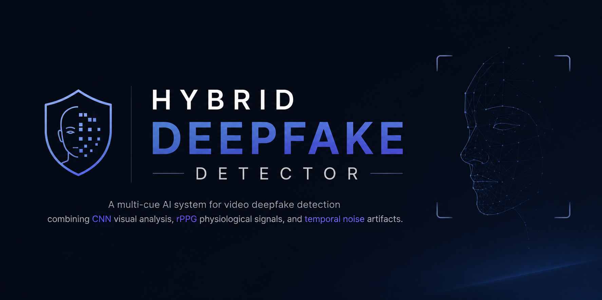
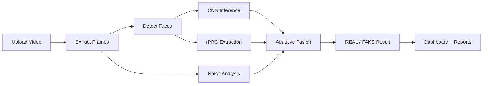

<div align="center">



# 🔍 Hybrid Deepfake Detector

**A multi-cue AI system for video deepfake detection — combining CNN visual analysis, rPPG physiological signals, and temporal noise artifacts.**

[](https://www.python.org/)
[](https://pytorch.org/)
[](https://streamlit.io/)
[](LICENSE)
[](https://github.com/DHP065/Hybrid-Deepfake-Detection)

[Features](#-key-features) •
[Architecture](#-system-architecture) •
[Installation](#-installation) •
[Usage](#-usage) •
[Output](#-sample-output) •
[Contributing](#-contributing)

</div>

---

## 📌 Project Status

| Item | Status |
|------|--------|
| **Core Detection Engine** | ✅ Stable |
| **Streamlit Web UI** | ✅ Stable |
| **PDF Report Generation** | ✅ Stable |
| **Model Training Pipeline** | ✅ Available |
| **ImageNet-Pretrained ResNet18 Backbone** | ✅ Included |
| **Production Deployment** | 🚧 Research / Academic prototype |

> **Note:** This is an academic mini-project and research prototype. Detection results should be treated as indicative, not forensic evidence.

---

## 🌟 Project Overview

**Hybrid Deepfake Detector** is an AI-powered system that analyzes uploaded videos using **multiple complementary techniques** instead of relying on a single model. By fusing CNN-based visual artifact detection, **Remote Photoplethysmography (rPPG)** for physiological signal analysis, and **temporal noise/artifact analysis**, the system aims to improve detection reliability over single-model approaches.

The project ships with:

- A **Python detection engine** (`hybrid_deepfake_detector.py`) for CLI and programmatic use
- An **interactive Streamlit dashboard** with visual analytics and PDF report generation
- Optional **training and evaluation scripts** for fine-tuning on custom datasets

---

## 💡 Why This Project?

Deepfakes are increasingly realistic and pose serious risks to media integrity, identity security, and public trust. Single-model detectors often fail when:

- Deepfakes are compressed or low quality
- Faces are partially occluded or poorly lit
- Generative techniques evolve faster than one classifier can adapt

This project explores a **hybrid, multi-signal approach**:

| Approach | Limitation of single-model systems | How this project addresses it |
|----------|-----------------------------------|-------------------------------|
| Visual-only CNN | Misses subtle temporal inconsistencies | Combines frame-level CNN with temporal noise analysis |
| Physiology-agnostic models | Ignores biological plausibility | Adds rPPG heartbeat signal analysis from facial regions |
| Fixed-weight fusion | One-size-fits-all scoring | Uses **adaptive score fusion** based on signal availability |

---

## ✨ Key Features

| Feature | Description |
|---------|-------------|
| 🎬 **Video Deepfake Detection** | Upload MP4, AVI, MOV, or MKV videos for analysis |
| 🧠 **CNN Visual Analysis** | ResNet18 binary classifier trained on FaceForensics++ |
| 💓 **rPPG Signal Analysis** | Extracts heartbeat-related signals from facial green-channel variations |
| 🔊 **Temporal Noise Analysis** | Detects frame-to-frame variance patterns indicative of artifacts |
| ⚖️ **Adaptive Score Fusion** | Dynamically weights CNN, rPPG, and noise cues |
| 📊 **Streamlit Dashboard** | Interactive web UI with gauges, charts, and threat/reliability badges |
| 📈 **Confidence Visualization** | Plotly bar charts and gauge charts for component breakdown |
| 📄 **PDF Report Generation** | Downloadable analysis reports from the web UI |
| 📋 **JSON Export** | Structured `report.json` output saved on every analysis run |
| ⏳ **Real-time Progress Tracking** | Step-by-step progress bar during video analysis |
| 🎯 **Sample Video Testing** | Built-in demo using included sample video |
| 🔧 **CLI Support** | Run detection from the terminal with configurable thresholds |
| 🏋️ **Training Pipeline** | Scripts for data prep, training, and model evaluation |

---

## 🏗️ System Architecture

```
                         ┌─────────────────┐
                         │  Input Video    │
                         └────────┬────────┘
                                  │
                                  ▼
                         ┌─────────────────┐
                         │ Frame Extraction│
                         │   (OpenCV)      │
                         └────────┬────────┘
                                  │
                                  ▼
                         ┌─────────────────┐
                         │ Face Detection  │
                         │  (MediaPipe)    │
                         └────────┬────────┘
                                  │
              ┌───────────────────┼───────────────────┐
              │                   │                   │
              ▼                   ▼                   ▼
     ┌────────────────┐  ┌────────────────┐  ┌────────────────┐
     │  CNN Analysis  │  │ rPPG Analysis  │  │ Temporal Noise │
     │  (ResNet18)    │  │ (Welch PSD)    │  │   Analysis     │
     └───────┬────────┘  └───────┬────────┘  └───────┬────────┘
             │                   │                   │
             └───────────────────┼───────────────────┘
                                 │
                                 ▼
                        ┌─────────────────┐
                        │ Adaptive Fusion │
                        │  (Weighted)     │
                        └────────┬────────┘
                                 │
                                 ▼
                        ┌─────────────────┐
                        │ REAL / FAKE     │
                        │   Prediction    │
                        └────────┬────────┘
                                 │
              ┌──────────────────┴──────────────────┐
              │                                     │
              ▼                                     ▼
     ┌─────────────────┐                 ┌─────────────────┐
     │ Streamlit UI    │                 │ JSON Report     │
     │ + PDF Export    │                 │ (report.json)   │
     └─────────────────┘                 └─────────────────┘
```

<details>
<summary><strong>🔬 Fusion Logic (Technical Details)</strong></summary>

Default fusion weights:

| Signal | Default Weight | Notes |
|--------|---------------|-------|
| CNN | 60% | ResNet18 fake-class probability (trimmed mean + median aggregation) |
| rPPG | 30% | Low SNR (< 5) increases fake likelihood |
| Noise | 10% | Frame-difference variance score |

Weights adapt automatically when:

- **rPPG is skipped or unavailable** → CNN 80%, Noise 20%
- **Few CNN predictions (< 5 frames)** → CNN weight capped at 50%, noise weight increased

Final decision: `FAKE` if fused score ≥ threshold (default `0.5`).

</details>

---

## 🔄 Project Workflow



| Step | Component | Output |
|------|-----------|--------|
| 1 | Video upload (UI or CLI) | Temporary / input video path |
| 2 | Frame extraction | RGB frame sequence + FPS |
| 3 | MediaPipe face detection | Cropped face regions |
| 4 | ResNet18 inference | Per-frame fake probabilities |
| 5 | rPPG (Welch PSD) | SNR + peak BPM |
| 6 | Temporal noise | Inter-frame variance score |
| 7 | Adaptive fusion | `final_score`, `decision` |
| 8 | Reporting | JSON + optional PDF via UI |

---

## 🛠️ Technologies Used

| Category | Tools & Libraries |
|----------|-------------------|
| **Language** | Python 3.10 / 3.11 |
| **Deep Learning** | PyTorch, TorchVision |
| **Computer Vision** | OpenCV, MediaPipe |
| **Signal Processing** | NumPy, SciPy (`welch`) |
| **Web Application** | Streamlit |
| **Visualization** | Plotly, Matplotlib, Seaborn |
| **Reporting** | ReportLab (PDF) |
| **Data & Utilities** | Pandas, tqdm, scikit-learn |
| **Training** | Custom PyTorch training pipeline |

---

## 📁 Folder Structure

```
Hybrid-Deepfake-Detection/
│
├── app.py                          # Streamlit web application
├── hybrid_deepfake_detector.py     # Core hybrid detection engine
├── train_model.py                  # Advanced model training script
├── quick_train.py                  # Quick fine-tuning script
├── prepare_data.py                 # Dataset preparation utilities
├── evaluate_model.py               # Model evaluation (ROC, confusion matrix)
├── run_app.bat                     # Windows one-click launcher
├── requirements.txt                # Python dependencies
│
├── models/
│   └── resnet18_ffpp.pth           # Pretrained ResNet18 weights (FaceForensics++)
│
├── samples/
│   └── fake.mp4                    # Sample video for demo/testing
│
├── out/                            # CLI analysis outputs (report.json)
├── temp_out/                       # Web UI analysis outputs
│
├── docs/
│   └── assets/                     # README banner & screenshots
│       └── banner.png              # Project header banner
│
├── TRAINING_GUIDE.md               # Detailed training documentation
├── UI_README.md                    # Streamlit UI quick reference
├── PROJECT_REPORT.md               # Academic project report (Markdown)
├── PROJECT_REPORT.pdf              # Academic project report (PDF)
└── README.md                       # You are here
```

---

## 📋 Prerequisites

| Requirement | Details |
|-------------|---------|
| **Python** | 3.10 or 3.11 (MediaPipe does **not** support 3.12+) |
| **RAM** | 8 GB minimum recommended |
| **GPU** | Optional — CUDA accelerates CNN inference |
| **Disk Space** | ~2 GB for dependencies + model weights |
| **OS** | Windows, Linux, or macOS |

---

## ⚙️ Installation

### 1. Clone the repository

```bash
git clone https://github.com/DHP065/Hybrid-Deepfake-Detection.git
cd Hybrid-Deepfake-Detection
```

### 2. Create a virtual environment

**Windows (PowerShell):**

```powershell
py -3.11 -m venv .venv
.venv\Scripts\activate
```

**Linux / macOS:**

```bash
python3.11 -m venv .venv
source .venv/bin/activate
```

### 3. Install dependencies

```bash
python -m pip install --upgrade pip
pip install -r requirements.txt
```

### 4. Verify model weights

Ensure the pretrained weights exist:

```
models/resnet18_ffpp.pth
```

> If missing, follow [TRAINING_GUIDE.md](TRAINING_GUIDE.md) to train or obtain compatible weights.

---

## 🚀 Usage

### Option A — Streamlit Web App (Recommended)

**Windows (quick launch):**

```bat
run_app.bat
```

**Manual launch:**

```bash
streamlit run app.py
```

Open your browser at `http://localhost:8501`, upload a video, and click **Analyze Video**.

**UI capabilities:**

- Drag-and-drop video upload (MP4, AVI, MOV, MKV — max ~200 MB)
- Real-time progress tracking
- REAL / FAKE result with confidence gauge
- Threat level and reliability badges
- Plotly metric breakdown charts
- PDF report download
- **Try with Sample Video** button (uses `samples/fake.mp4`)

---

### Option B — Command Line Interface

```bash
python hybrid_deepfake_detector.py --video path/to/video.mp4 --out out
```

**Optional arguments:**

| Argument | Default | Description |
|----------|---------|-------------|
| `--video` | *(required)* | Path to input video |
| `--out` | `out` | Output directory for `report.json` |
| `--threshold` | `0.5` | Decision threshold for FAKE classification |
| `--fake_class_index` | `1` | Model output index representing the fake class |

**Example:**

```bash
python hybrid_deepfake_detector.py --video samples/fake.mp4 --out out --threshold 0.5
```

---

### Option C — Programmatic API

```python
from hybrid_deepfake_detector import HybridDeepfakeDetector

detector = HybridDeepfakeDetector(
    model_path="models/resnet18_ffpp.pth",
    threshold=0.5,
    fake_class_index=1,
)

report = detector.analyze("samples/fake.mp4", out_dir="out")
print(report["decision"], report["final_score"])
```

---

<details>
<summary><strong>🏋️ Model Training (Optional)</strong></summary>

See [TRAINING_GUIDE.md](TRAINING_GUIDE.md) for full instructions.

**Quick fine-tuning:**

```bash
python quick_train.py --epochs 10 --batch_size 16 --lr 1e-4
```

**Advanced training:**

```bash
python train_model.py --architecture resnet50 --epochs 50 --use_mixup --use_focal_loss
```

**Evaluate a trained model:**

```bash
python evaluate_model.py --model_path models/your_model.pth --data_dir data/test
```

</details>

---

## 📤 Sample Output

```text
================================================

Video Analysis Completed

Prediction      : FAKE

Confidence      : 94.21%

CNN Score       : 0.91

rPPG Signal     : Stable

Noise Score     : 0.74

Processing Time : 11.3 seconds

================================================
```

---

## 📊 Performance Highlights

| Aspect | Detail |
|--------|--------|
| **Architecture** | ResNet18 binary classifier (real vs. fake) |
| **Pretraining** | FaceForensics++ compatible weights |
| **Inference** | Batched CNN inference with optional CUDA AMP |
| **Frame Sampling** | Up to ~64 sampled frames per video for CNN |
| **Fusion Strategy** | Adaptive weighting across CNN, rPPG, and noise |
| **Evaluation Tools** | ROC curves, confusion matrices via `evaluate_model.py` |

<details>
<summary><strong>⚠️ Performance Disclaimer</strong></summary>

Detection accuracy depends heavily on:

- Video quality, compression, and lighting
- Face visibility and size in frame
- Deepfake generation method (face swap, lip re-enactment, full synthesis, etc.)
- Whether the pretrained weights match the type of deepfake in the video

This system is a **research prototype** — always validate critical decisions with human review and specialized forensic tools.

</details>

---

## 🔮 Future Improvements

- [ ] Expand training dataset beyond FaceForensics++ for better generalization
- [ ] Add Grad-CAM / saliency visualizations for CNN explainability
- [ ] Support batch video processing and REST API deployment
- [ ] Improve rPPG robustness under motion and poor lighting
- [ ] Add unit and integration tests for the fusion pipeline
- [ ] Docker containerization for reproducible deployment
- [ ] Real-time webcam analysis mode
- [ ] Model ensemble with EfficientNet / Vision Transformer backends

---

## 🧗 Challenges Faced

| Challenge | How it was addressed |
|-----------|---------------------|
| **MediaPipe Python version constraints** | Standardized on Python 3.10/3.11 with documented setup |
| **Single-model false positives/negatives** | Designed hybrid fusion across visual, physiological, and temporal cues |
| **Variable video quality** | Trimmed-mean aggregation for CNN probabilities; adaptive fusion weights |
| **rPPG signal instability** | Graceful fallback when insufficient facial frames or low SNR |
| **Label index ambiguity** | Alternative scoring path with configurable `fake_class_index` |
| **User-facing interpretability** | Streamlit dashboard with component breakdown and PDF reports |

---

## 🎓 Learning Outcomes

Through this project, I gained hands-on experience in:

- Building **multi-modal ML pipelines** that combine deep learning and signal processing
- **Face detection and video preprocessing** with MediaPipe and OpenCV
- **Remote photoplethysmography (rPPG)** for non-contact physiological signal extraction
- **Score fusion and thresholding** for robust binary classification
- Deploying ML models with **Streamlit** for interactive demos
- **PyTorch training workflows** including data augmentation, evaluation metrics, and checkpointing
- Generating **structured reports** (JSON + PDF) for reproducible analysis outputs

---

## 🤝 Contributing

Contributions are welcome! Please follow these steps:

1. **Fork** the repository
2. **Create** a feature branch: `git checkout -b feature/your-feature-name`
3. **Commit** your changes: `git commit -m "Add: your feature description"`
4. **Push** to the branch: `git push origin feature/your-feature-name`
5. **Open** a Pull Request

### Contribution Guidelines

- Keep changes focused and well-scoped
- Match existing code style and naming conventions
- Do not commit model weights, videos, or virtual environments
- Update documentation when adding user-facing features
- Test on Python 3.10 or 3.11 before submitting

---

## 🐛 Troubleshooting

<details>
<summary><strong>MediaPipe / Python version errors</strong></summary>

```
ERROR: Could not find a version that satisfies the requirement mediapipe
```

**Fix:** Use Python 3.10 or 3.11. MediaPipe does not support Python 3.12+.

```bash
py -3.11 -m venv .venv
```

</details>

<details>
<summary><strong>Model weights not found</strong></summary>

```
[WARNING] No pretrained model found, model will be untrained!
```

**Fix:** Place compatible weights at `models/resnet18_ffpp.pth`, or train using `quick_train.py` / `train_model.py`.

</details>

<details>
<summary><strong>No faces detected / CNN skipped</strong></summary>

Ensure the video contains clearly visible frontal faces with adequate resolution. Very dark, blurry, or heavily cropped videos may fail face detection.

</details>

<details>
<summary><strong>rPPG warnings</strong></summary>

```
[WARNING] Not enough signals for rPPG
```

**Cause:** Insufficient consecutive frames with detectable faces.  
**Effect:** Fusion automatically reweights toward CNN and noise signals.

</details>

<details>
<summary><strong>CUDA / GPU issues</strong></summary>

The detector falls back to CPU automatically if CUDA is unavailable. For GPU support, install a CUDA-compatible PyTorch build from [pytorch.org](https://pytorch.org/get-started/locally/).

</details>

<details>
<summary><strong>Streamlit port already in use</strong></summary>

```bash
streamlit run app.py --server.port 8502
```

</details>

---

## ❓ FAQ

<details>
<summary><strong>Does this analyze audio or lip-sync?</strong></summary>

**No.** This system analyzes **video frames only** — CNN visual features, rPPG from facial color changes, and temporal frame noise. There is no audio or lip-sync analysis in the current implementation.

</details>

<details>
<summary><strong>Can I use this for legal or forensic evidence?</strong></summary>

**No.** This is an academic/research prototype. It should not be used as sole evidence in legal, journalistic, or security-critical contexts without expert validation.

</details>

<details>
<summary><strong>What video formats are supported?</strong></summary>

MP4, AVI, MOV, and MKV. MP4 generally works best. Keep files under ~200 MB for responsive UI performance.

</details>

<details>
<summary><strong>Where is the JSON report saved?</strong></summary>

- **CLI:** `{--out}/report.json` (default: `out/report.json`)
- **Web UI:** `temp_out/report.json`

</details>

<details>
<summary><strong>Can I train on my own dataset?</strong></summary>

Yes. Organize data as `data/real/` and `data/fake/` image folders, then follow [TRAINING_GUIDE.md](TRAINING_GUIDE.md).

</details>

---

## 📚 Citation

If you use this project in academic work, please cite:

```bibtex
@misc{hybrid_deepfake_detector,
  author       = {Devansh Himanshu Patel and Ankit Singh and Akshay Yellaram and Smiti Patil},
  title        = {Hybrid Deepfake Detector: Multi-Cue Video Analysis with CNN, rPPG, and Temporal Noise Fusion},
  year         = {2026},
  publisher    = {GitHub},
  howpublished = {\url{https://github.com/DHP065/Hybrid-Deepfake-Detection}}
}
```

---

## 📄 License

This project is licensed under the **MIT License** — see the [LICENSE](LICENSE) file for details.

---

## 👥 Authors

<table>
<tr>

<td align="center">

<b>Devansh Himanshu Patel</b><br><br>

<a href="https://github.com/DHP065">

</a>

</td>

<td align="center">

<b>Ankit Singh</b>

</td>

<td align="center">

<b>Akshay Yellaram</b>

</td>

<td align="center">

<b>Smiti Patil</b>

</td>

</tr>
</table>

<div align="center">

Computer Engineering Mini Project (2026)

</div>

---

## 🙏 Acknowledgements

- [FaceForensics++](https://github.com/ondyari/FaceForensics) — Deepfake dataset and benchmark inspiration
- [MediaPipe](https://developers.google.com/mediapipe) — Fast and reliable face detection
- [PyTorch](https://pytorch.org/) & [TorchVision](https://pytorch.org/vision/) — Deep learning framework and ResNet architectures
- [Streamlit](https://streamlit.io/) — Rapid interactive web app development
- [ReportLab](https://www.reportlab.com/) — PDF report generation
- [Plotly](https://plotly.com/) — Interactive data visualizations

---

## 🏷️ Repository Topics

Add these topics on GitHub (**Settings → General → Topics**):

```
deepfake-detection
deepfake
computer-vision
pytorch
streamlit
mediapipe
rppg
resnet18
face-forensics
video-analysis
machine-learning
ai
opencv
signal-processing
multimodal-ai
```

---

<div align="center">

**⭐ If you found this project useful, please consider giving it a star!**

Made with ❤️ for learning, research, and open-source collaboration.

</div>
